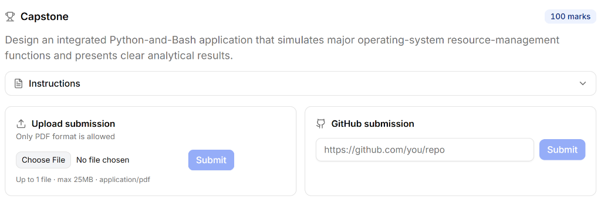

# Capstone Assignment Instructions & Evaluation Rubric

## Project Title
**Design an integrated Python-and-Bash application that simulates major operating-system resource-management functions and presents clear analytical results.**

- **Total Marks:** 100 Marks
- **Submission Requirements:**
  - **Upload submission:** Only PDF format is allowed (Up to 1 file, max 25MB, `application/pdf`).
  - **GitHub submission:** [https://github.com/krishnakrsingh/os-simsuite](https://github.com/krishnakrsingh/os-simsuite)
  - **Deliverable package:** One working application containing source code, README/execution steps, sample input, output traces, screenshots, test cases, and a concise report. The work should run as an integrated project rather than a collection of unrelated programs.

---

## Assignment Portal Reference Image

---

## Detailed Evaluation Rubric

| Phase | Meaningful Title | Task to be Completed | Evidence / Submission | Marks |
| :---: | :--- | :--- | :--- | :---: |
| **Phase 1** | **System Design and Planning** | Define modules for process scheduling, memory, deadlock, storage and reporting; prepare input/output flow and data structures. | Problem clarity, modular architecture, workflow, data design and implementation plan. | **20** |
| **Phase 2** | **Core Resource-Management Modules** | Implement at least three major OS modules using Python, with Bash integration where relevant. | Correct implementation, reusable functions/classes, readable code and working menu flow. | **20** |
| **Phase 3** | **Analysis and Comparison** | Run common datasets, compare algorithms and generate tables or charts for performance measures. | Valid metrics, meaningful comparison, labelled visualization and technical observations. | **20** |
| **Phase 4** | **Testing and Reliability** | Test valid, invalid and boundary inputs; add exception handling and activity logging. | Test quality, robust validation, error handling, correctness and reliability. | **20** |
| **Phase 5** | **Documentation and Demonstration** | Present the final system, explain results and submit the repository/file with complete documentation. | README, execution evidence, screenshots, report, demonstration and originality. | **20** |
| **Total** | | | | **100** |

---

## Key Core Requirements & Guidelines
1. **Integrated System:** The project must function as a cohesive single application (not isolated, standalone scripts). A central controller must drive all modules through an interactive menu and a command-line interface.
2. **Python & Bash Synergy:** Core simulation logic implemented cleanly in Python 3.10+, orchestrated and automated with native Bash shell scripts (pipeline execution, health checks, benchmark runners).
3. **Four Operating System Resource Domains:**
   - **CPU Process Scheduling:** FCFS, SJF (Preemptive/Non-preemptive), Priority (Preemptive/Non-preemptive), Round Robin.
   - **Memory Management:** Contiguous allocation strategies (First-Fit, Best-Fit, Worst-Fit) and Virtual Memory Page Replacement (FIFO, LRU, Optimal).
   - **Deadlock Management:** Dijkstra's Banker's Algorithm (System Safety Verification & Resource-Request Evaluation).
   - **Storage / Disk Scheduling:** FCFS, SSTF, SCAN, C-SCAN, LOOK, C-LOOK algorithms.
4. **Analysis & Visualizations:** Comparative analysis running identical benchmark datasets, generating summary metrics tables and publication-quality Matplotlib figures (Gantt charts, seek curves, page fault rate comparisons).
5. **Quality & Reliability:** Rigorous exception handling for boundary and invalid inputs, structured logging, and unit test coverage.
6. **Final Documentation:** Concise, complete report exportable to a submission-ready PDF (under 25MB) alongside documented execution traces and terminal screenshots.
