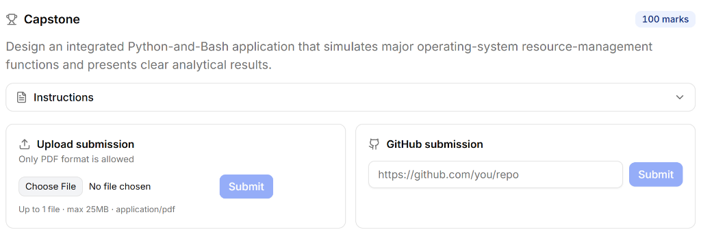
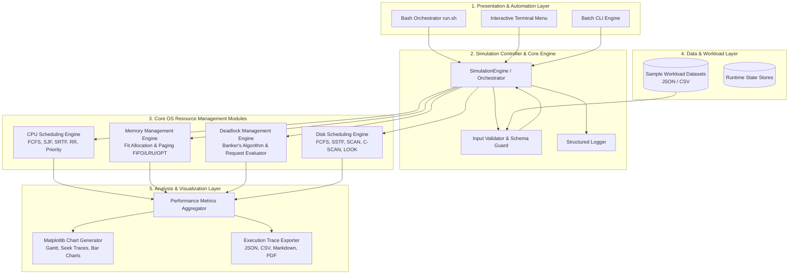
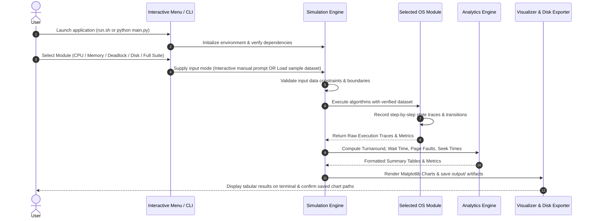

# OS Simulation Suite (OS-SimSuite)
## Phase 1: System Design and Planning Specification
**Course / Evaluation:** Capstone Project (100 Marks)  
**Document Phase:** Phase 1 — System Design & Planning (20 Marks)  
**Target Platform:** Python 3.10+ & Bash (POSIX / Linux / macOS / Windows WSL & Git Bash)  
**Version:** 1.0.0  

---



---

## 1. Problem Clarity, Executive Summary & Scope

### 1.1 Context and Background
Modern operating systems (OS) act as the primary resource managers for computing hardware. At the heart of any general-purpose OS lie foundational subsystems responsible for arbitrating scarce computational resources:
1. **Central Processing Unit (CPU):** Dynamically arbitrated via Process Scheduling algorithms to maximize CPU utilization, optimize throughput, and minimize latency.
2. **Primary Memory (RAM):** Managed via dynamic contiguous allocation strategies (minimizing fragmentation) and virtual memory page replacement policies (minimizing page faults).
3. **System Synchronization & Resource Allocation:** Governed by Deadlock Avoidance algorithms (e.g., Dijkstra's Banker's Algorithm) to guarantee system state safety during competitive resource acquisition.
4. **Secondary Storage (Disk I/O):** Arbitrated through Disk Head Scheduling algorithms to reduce mechanical/rotational seek times and prevent track starvation.

In academic and systems engineering contexts, analyzing how these algorithms behave under identical, fluctuating, or pathological workloads is essential. Most existing simulators are isolated, disparate scripts with non-standardized I/O, incompatible data formats, and lacking unified analytics or automation.

### 1.2 Project Vision & Objectives
The **OS-SimSuite** is an integrated, production-grade simulation and analytics platform written in Python with native Bash workflow automation. It provides:
- **Unified Modular Architecture:** An extensible object-oriented core simulating the four primary resource management domains under a shared execution lifecycle.
- **Dual Execution Interfaces:** A rich interactive CLI terminal menu for exploratory testing alongside a headless scriptable CLI for automated batch benchmarking.
- **Bash Integration:** Native Bash scripts orchestrating workload generation, multi-algorithm batch executions, automated regression testing, and system telemetry logging.
- **Empirical Analysis & Visualization:** Direct generation of publication-quality comparative metrics tables and Matplotlib visualizations (Gantt charts, seek path plots, page fault curves).
- **Fault-Tolerant Reliability:** Strict schema validation, boundary condition handling (zero burst, memory overflow, cyclic resource deadlocks), and detailed audit logging.

### 1.3 Scope and Boundary Matrix
| Dimension | In-Scope | Out-of-Scope (Design Constraints) |
| :--- | :--- | :--- |
| **Execution Environment** | Python 3.10+ standard runtime + Matplotlib/Tabulate; Bash shell automation (`.sh`) + Windows cross-platform compatibility (`.ps1` companion). | Bare-metal kernel extensions or C/C++ hardware drivers. |
| **Process Scheduling** | FCFS, SJF (Preemptive SRTF & Non-Preemptive), Priority (Preemptive & Non-Preemptive), Round Robin (variable quantum). | Real-time hard deadlines (Earliest Deadline First) or multi-core SMP affinity scheduling. |
| **Memory Management** | Contiguous allocation (First-Fit, Best-Fit, Worst-Fit) with compaction & fragmentation analysis; Virtual Memory Paging (FIFO, LRU, Optimal). | Segmented paging hardware MMU translation tables or TLB hardware caching. |
| **Deadlock Management** | Banker's Algorithm for multiple resource types (Safety Sequence Algorithm & Resource-Request Verification). | Distributed deadlock detection (Chandy-Misra-Haas). |
| **Storage / Disk** | FCFS, SSTF, SCAN, C-SCAN, LOOK, C-LOOK with track boundary handling and total seek distance computation. | RAID level simulations or NVMe flash block wear leveling. |
| **Analysis & Reporting** | Comparative metric tables, Matplotlib graphical plots, JSON/CSV execution traces, Markdown/PDF report generation. | Cloud-hosted web dashboards (focus is on terminal and report artifact delivery). |

---

## 2. Modular Architecture & Workflow Design

### 2.1 Architectural Overview
The system follows a clean, decoupled, layered architectural pattern:
1. **Presentation & Automation Layer:**
   - Bash Orchestration Scripts (`run.sh`, `benchmark_runner.sh`, `health_check.sh`).
   - Interactive Terminal UI (`src/cli/menu.py`) using formatted menus and ANSI color formatting.
   - Headless Batch CLI (`main.py --batch --config <file>`).
2. **Controller & Orchestration Layer (`src/engine.py`):**
   - Coordinates workload loading, module dispatching, execution lifecycle, and routing outputs to reporting engines.
3. **Core OS Simulation Modules (`src/modules/`):**
   - `cpu_scheduler.py`: Process queues, time-slicing, preemptive/non-preemptive scheduling.
   - `memory_manager.py`: Partition tables, allocation trackers, paging frames, page replacement policies.
   - `deadlock_guard.py`: Allocation matrices, max matrices, available vectors, safe sequence solver.
   - `disk_scheduler.py`: Request queue arbitration, head motion tracking, boundary turnaround.
4. **Analytics & Visualization Layer (`src/analytics/`):**
   - `metrics.py`: Statistical aggregations (mean waiting time, throughput, hit ratios, seek totals).
   - `visualizer.py`: Matplotlib rendering of Gantt charts, seek graphs, and comparative bar charts.
5. **Persistence & Infrastructure Layer (`src/utils/`):**
   - `logger.py`: Centralized logging with console handlers and timestamped audit logs.
   - `validator.py`: Strict schema and data validation for JSON/CSV inputs and runtime parameters.

### 2.2 System Component Diagram (Mermaid)


### 2.3 Interactive Workflow & Execution Lifecycle
The execution lifecycle follows a deterministic 5-step pipeline:



---

## 3. Detailed Module Specifications & Algorithms

### 3.1 Module 1: CPU Process Scheduling Engine
- **Objective:** Model processor execution across independent tasks arriving over time with varying bursts and priorities.
- **Implemented Algorithms:**
  1. **First-Come, First-Served (FCFS):** Non-preemptive, ordered strictly by arrival time.
  2. **Shortest Job First (SJF - Non-Preemptive):** Prioritizes processes with shortest CPU burst once arrived.
  3. **Shortest Remaining Time First (SRTF - Preemptive SJF):** Dynamically interrupts current running process if a newly arrived process possesses a shorter remaining CPU burst.
  4. **Priority Scheduling (Preemptive & Non-Preemptive):** Arbitrates based on integer priority levels (lower numeric value = higher priority), with arrival tie-breaking.
  5. **Round Robin (RR):** Preemptive time-slicing using a configurable `quantum` $\delta$. Handles arrival interleaving into the ready queue accurately.
- **Key Metrics Computed:**
  - Completion Time ($C_i$)
  - Turnaround Time ($TAT_i = C_i - A_i$)
  - Waiting Time ($WT_i = TAT_i - BT_i$)
  - Response Time ($RT_i = FirstStartTime_i - A_i$)
  - CPU Utilization ($\% = \frac{\sum BT_i}{\text{Total Schedule Time}} \times 100$)
  - Throughput ($\text{processes} / \text{time unit}$)
  - Complete Gantt Chart sequence with exact start and end timestamps.

### 3.2 Module 2: Memory Management Subsystem
The memory module models two core aspects of physical and virtual memory management:
- **Part A: Dynamic Contiguous Partitioning:**
  - Simulates a contiguous physical memory address space of size $M$ bytes/KB divided into partitions.
  - Algorithms:
    - **First-Fit:** Allocates the first free hole large enough.
    - **Best-Fit:** Allocates the smallest free hole large enough (minimizing immediate leftover space).
    - **Worst-Fit:** Allocates the largest free hole available (leaving maximum remainder for subsequent tasks).
  - Features: Dynamic deallocation, partition merging (coalescing adjacent free blocks), external and internal fragmentation computation, and memory compaction simulation.
- **Part B: Virtual Memory Page Replacement:**
  - Simulates an execution sequence of memory page references across a fixed number of physical page frames.
  - Algorithms:
    - **FIFO (First-In, First-Out):** Evicts the oldest loaded page frame; tracks Belady's Anomaly.
    - **LRU (Least Recently Used):** Tracks temporal locality and evicts the frame unreferenced for the longest duration.
    - **Optimal (OPT / MIN):** Looks ahead into the future reference string and replaces the page that will not be used for the longest period of time (theoretical benchmark).
  - Metrics: Total Page References, Page Hits, Page Faults, Hit Ratio ($Hits / Total$), Fault Ratio ($Faults / Total$).

### 3.3 Module 3: Deadlock Avoidance (Banker's Algorithm)
- **Objective:** Evaluate safe states and safe execution sequences in a multi-resource, multi-process environment.
- **Theoretical Formulation:**
  - Available Vector $A[m]$: Available units of $m$ resource types.
  - Max Matrix $M[n \times m]$: Maximum demand of process $P_i$ for resource $R_j$.
  - Allocation Matrix $Alloc[n \times m]$: Resources currently allocated to process $P_i$.
  - Need Matrix $Need[n \times m] = M[i][j] - Alloc[i][j]$.
- **Capabilities:**
  1. **Safety Algorithm:** Computes whether the current system state is safe; if safe, determines the complete Safe Sequence (e.g., $\langle P_1, P_3, P_4, P_0, P_2 \rangle$); if unsafe, identifies deadlock risks.
  2. **Resource-Request Algorithm:** Validates dynamic resource requests ($Req_i \le Need_i$ and $Req_i \le Available$), simulates speculative allocation, executes the Safety Algorithm on the candidate state, and either grants or rolls back the request with detailed diagnostic feedback.

### 3.4 Module 4: Storage & Disk Head Scheduling Subsystem
- **Objective:** Simulate hard disk drive head movement across concentric cylindrical tracks to satisfy a queue of cylinder I/O requests.
- **Implemented Algorithms:**
  1. **FCFS (First-Come, First-Served):** Processes requests in strict arrival order.
  2. **SSTF (Shortest Seek Time First):** Service the pending request closest to the current head position.
  3. **SCAN (Elevator Algorithm):** Head moves in one direction servicing requests until reaching the disk boundary, then reverses.
  4. **C-SCAN (Circular SCAN):** Head moves in one direction to the boundary, then immediately returns to the opposite boundary without servicing requests on the return sweep.
  5. **LOOK:** Like SCAN, but reverses direction immediately after servicing the final request in the current direction (avoids redundant travel to disk boundaries).
  6. **C-LOOK:** Circular variant of LOOK; jumps to the furthest opposite request without servicing requests during return.
- **Key Metrics Computed:**
  - Total Head Movement (Total Seek Distance in cylinders).
  - Average Seek Distance ($\text{Total Seek} / N$).
  - Full Seek Sequence Trace (order of cylinder visits).
  - Visual Head Trajectory Plots showing track traversal over time.

### 3.5 Module 5: Integrated Reporting, Analytics & Visualizations
- **Comparative Multi-Run Benchmarking:** Feeds identical workloads to competing algorithms within each module to generate apples-to-apples performance comparisons.
- **Graphical Artifact Generation:**
  - CPU Scheduling: Color-coded Horizontal Gantt charts with process idle times.
  - Page Replacement: Comparative bar charts showing Page Faults and Hit Ratios across FIFO, LRU, and OPT.
  - Disk Scheduling: Trajectory line plots displaying head movement across cylinder numbers.
  - Comprehensive Markdown & PDF reports summarizing test parameters, execution traces, and recommendations.

---

## 4. Formal Data Design & Structures

All internal structures utilize Python 3.10+ dataclasses, type hints, and immutable state snapshots where applicable to guarantee zero race conditions and high simulation fidelity.

### 4.1 Process Scheduling Data Models
```python
from dataclasses import dataclass, field
from typing import List, Optional

@dataclass
class Process:
    pid: str
    arrival_time: int
    burst_time: int
    priority: int = 0
    # Dynamic Simulation State
    remaining_time: int = field(init=False)
    start_time: Optional[int] = None
    completion_time: Optional[int] = None
    waiting_time: Optional[int] = None
    turnaround_time: Optional[int] = None
    response_time: Optional[int] = None

    def __post_init__(self):
        self.remaining_time = self.burst_time

@dataclass
class GanttSlice:
    pid: str
    start_time: int
    end_time: int

@dataclass
class ScheduleResult:
    algorithm_name: str
    gantt_chart: List[GanttSlice]
    process_metrics: List[Process]
    average_waiting_time: float
    average_turnaround_time: float
    average_response_time: float
    cpu_utilization_pct: float
    throughput: float
    total_simulation_time: int
```

### 4.2 Memory Management Data Models
```python
@dataclass
class MemoryBlock:
    block_id: int
    start_address: int
    size: int
    is_allocated: bool = False
    process_id: Optional[str] = None
    internal_fragmentation: int = 0

@dataclass
class PageReferenceTrace:
    step: int
    page_referenced: int
    frames_snapshot: List[Optional[int]]
    is_fault: bool
    evicted_page: Optional[int] = None

@dataclass
class PagingResult:
    algorithm_name: str
    frame_count: int
    total_references: int
    page_faults: int
    page_hits: int
    hit_ratio: float
    fault_ratio: float
    traces: List[PageReferenceTrace]
```

### 4.3 Deadlock Avoidance Data Models
```python
import numpy as np

@dataclass
class BankerSystemState:
    process_ids: List[str]
    resource_names: List[str]
    available: List[int]
    maximum: List[List[int]]
    allocation: List[List[int]]
    need: List[List[int]] = field(init=False)

    def __post_init__(self):
        max_arr = np.array(self.maximum)
        alloc_arr = np.array(self.allocation)
        self.need = (max_arr - alloc_arr).tolist()

@dataclass
class SafetyResult:
    is_safe: bool
    safe_sequence: List[str]
    state_history: List[dict]
    explanation: str

@dataclass
class RequestResult:
    granted: bool
    message: str
    resulting_state: Optional[BankerSystemState] = None
    safe_sequence: Optional[List[str]] = None
```

### 4.4 Disk Scheduling Data Models
```python
@dataclass
class DiskSimulationResult:
    algorithm_name: str
    initial_head: int
    direction: str  # 'LEFT' or 'RIGHT'
    disk_size: int
    request_queue: List[int]
    seek_sequence: List[int]
    total_head_movement: int
    average_seek_distance: float
```

---

## 5. Input / Output Flow and File Formats

The system supports both interactive console inputs (with input validation) and standardized file inputs (JSON/CSV) for automated headless batch processing.

### 5.1 Input Schema Specifications
Sample JSON schema for complete multi-module workload (`data/sample_workload.json`):
```json
{
  "cpu_scheduling": {
    "processes": [
      {"pid": "P1", "arrival_time": 0, "burst_time": 8, "priority": 3},
      {"pid": "P2", "arrival_time": 1, "burst_time": 4, "priority": 1},
      {"pid": "P3", "arrival_time": 2, "burst_time": 9, "priority": 4},
      {"pid": "P4", "arrival_time": 3, "burst_time": 5, "priority": 2}
    ],
    "round_robin_quantum": 3
  },
  "memory_partitioning": {
    "total_memory_size": 1000,
    "initial_partitions": [100, 500, 200, 300, 600],
    "process_requests": [
      {"pid": "Job1", "size": 212},
      {"pid": "Job2", "size": 417},
      {"pid": "Job3", "size": 112},
      {"pid": "Job4", "size": 426}
    ]
  },
  "page_replacement": {
    "frame_capacity": 3,
    "reference_string": [7, 0, 1, 2, 0, 3, 0, 4, 2, 3, 0, 3, 2, 1, 2, 0, 1, 7, 0, 1]
  },
  "deadlock_bankers": {
    "resource_types": ["A", "B", "C"],
    "available": [3, 3, 2],
    "processes": ["P0", "P1", "P2", "P3", "P4"],
    "allocation": [
      [0, 1, 0],
      [2, 0, 0],
      [3, 0, 2],
      [2, 1, 1],
      [0, 0, 2]
    ],
    "maximum": [
      [7, 5, 3],
      [3, 2, 2],
      [9, 0, 2],
      [2, 2, 2],
      [4, 3, 3]
    ]
  },
  "disk_scheduling": {
    "initial_head_position": 53,
    "previous_head_position": 50,
    "disk_cylinders": 200,
    "requests": [98, 183, 37, 122, 14, 124, 65, 67]
  }
}
```

### 5.2 Output Artifacts Architecture
Outputs are written deterministically to the `output/` directory:
- `output/traces/`: Serialized JSON and plain-text execution logs detailing step-by-step state changes.
- `output/tables/`: CSV and ASCII tables comparing algorithms on standard datasets.
- `output/figures/`: High-resolution PNG visual plots (Gantt charts, page fault histograms, disk seek paths).
- `output/reports/`: Markdown summary and comprehensive PDF reports.

---

## 6. Bash and Python Integration Strategy

The project features deep integration between standard Linux/POSIX Bash automation scripts and the Python runtime:

```
├── run.sh                    # Primary entry point: checks environment, launches menu or batch mode
├── scripts/
│   ├── benchmark_runner.sh   # Bash pipeline executing multi-algorithm benchmarks in parallel
│   ├── health_check.sh       # Validates Python version, virtualenv, dependencies, disk permissions
│   └── generate_report.sh    # Aggregates output logs and invokes the PDF compilation pipeline
```

### 6.1 Unified CLI & Bash Wrapper Capabilities
- `run.sh --interactive` : Launches the terminal UI menu with curses/rich styling.
- `run.sh --batch <file>` : Runs all 4 modules on a specified JSON input file without UI prompts.
- `run.sh --compare <module>` : Runs comparative analysis across all algorithms in a specific module.
- `run.sh --test` : Executes the test suite with coverage reporting.

Cross-Platform Windows Fallback:
For native Windows execution without WSL/Git Bash, a companion `run.ps1` PowerShell script is provided with matching flags.

---

## 7. Comprehensive Implementation Plan & Milestones

Following the Capstone 100-mark rubric, the project implementation spans 5 distinct phases:

| Phase | Milestone Name | Key Deliverables & Technical Goals | Target Timeline | Rubric Marks |
| :---: | :--- | :--- | :---: | :---: |
| **Phase 1** | **System Design & Planning** | • Problem clarity & architectural specification<br/>• Comprehensive data models & schema definitions<br/>• I/O flow and modular lifecycle design<br/>• Implementation roadmap and test matrix | Week 1 | **20 Marks** |
| **Phase 2** | **Core Resource-Management Modules** | • CPU Scheduling Engine (FCFS, SJF, SRTF, RR, Priority)<br/>• Memory Allocation (First/Best/Worst) & Paging (FIFO/LRU/OPT)<br/>• Deadlock Banker's Engine (Safety & Request)<br/>• Disk Scheduling Engine (FCFS, SSTF, SCAN, LOOK)<br/>• Interactive menu controller & CLI argument parser | Week 2 | **20 Marks** |
| **Phase 3** | **Analysis and Comparison** | • Standard benchmark workloads (`data/standard_benchmark.json`)<br/>• Multi-algorithm comparative analysis runners<br/>• Matplotlib visualization generator (Gantt, bar charts, trajectory graphs)<br/>• Tabular metrics comparison exporters (Markdown, CSV) | Week 3 | **20 Marks** |
| **Phase 4** | **Testing and Reliability** | • Comprehensive test suite (`pytest`) covering valid, invalid, and boundary cases<br/>• Exception handling hierarchy (invalid quantum, negative bursts, out-of-bound tracks)<br/>• Centralized logging with rotation and audit trails<br/>• Code quality checks and test coverage > 90% | Week 4 | **20 Marks** |
| **Phase 5** | **Documentation and Demonstration** | • Comprehensive README with installation & execution guides<br/>• Automated PDF report generation (report.pdf for submission)<br/>• Recorded execution traces & terminal screenshots<br/>• Final verification against all evaluation criteria | Week 5 | **20 Marks** |
| **Total** | | | | **100 Marks** |

---

## 8. Test and Verification Matrix (Phase 4 Preview)

To ensure the highest reliability and meet Phase 4 requirements, the following test cases are planned:

| Module | Test Category | Specific Test Case | Expected Behavior |
| :--- | :--- | :--- | :--- |
| **CPU Scheduling** | Boundary | Single process, Zero burst time | Raise `ValidationError("Burst time must be > 0")` |
| **CPU Scheduling** | Edge Case | Simultaneous arrivals with equal priority | Stable deterministic tie-break by PID order |
| **CPU Scheduling** | Stress | High process count ($N=1000$) with tiny quantum | Measure scheduler overhead and verify conservation of total burst |
| **Memory Allocation** | Boundary | Request size exceeds maximum available block | Return allocation failure gracefully; trigger compaction prompt |
| **Memory Paging** | Algorithmic | Belady's Anomaly test case (FIFO frames 3 vs 4) | Accurately detect and log increase in page faults |
| **Memory Paging** | Consistency | Identical reference string across FIFO, LRU, OPT | OPT page faults $\le$ LRU $\le$ FIFO (validation rule) |
| **Deadlock Banker's** | Edge Case | Request exceeds declared Maximum Demand | Reject immediately: `Error: Request exceeds declared Max need` |
| **Deadlock Banker's** | Safety | Known textbook unsafe state | Confirm `is_safe == False`, identify blocked processes |
| **Disk Scheduling** | Boundary | Request cylinder = 0 or Cylinder = Max | Correct boundary bounce in SCAN and C-SCAN without overflow |
| **Disk Scheduling** | Edge Case | Head starting directly on an existing request | Service immediately with 0 seek distance; continue trajectory |
| **Integration** | CLI & Bash | Missing configuration file or corrupted JSON | Catch gracefully, display formatted error, exit with non-zero code |

---

## 9. Conclusion of Phase 1
Phase 1 establishes the theoretical foundation, software architecture, data structures, and implementation roadmap for **OS-SimSuite**. The system design is directly aligned with the 100-mark rubric, ensuring a cohesive, modular, and robust application across all succeeding phases.
