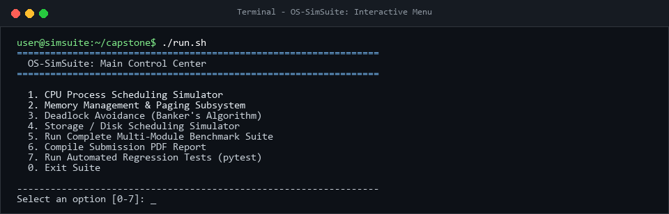
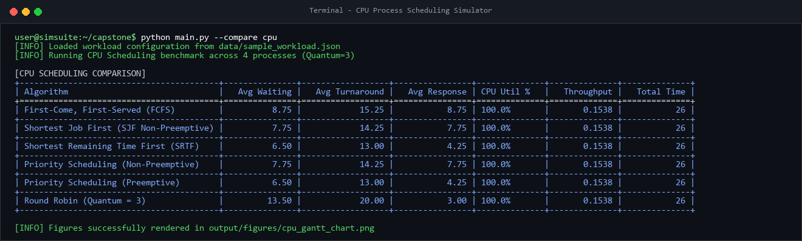
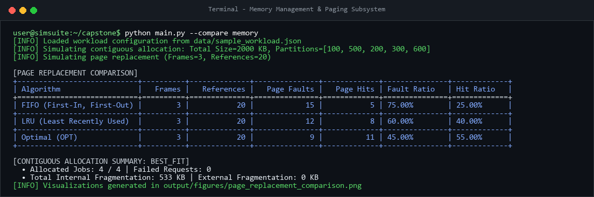
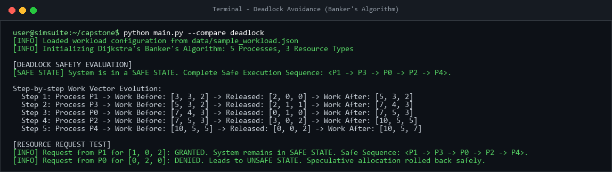
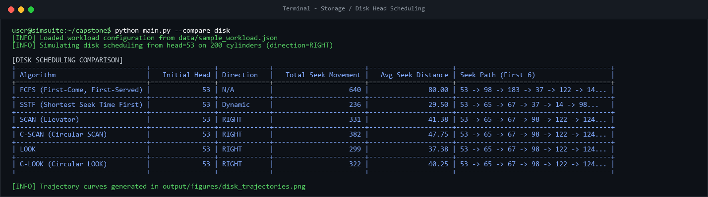
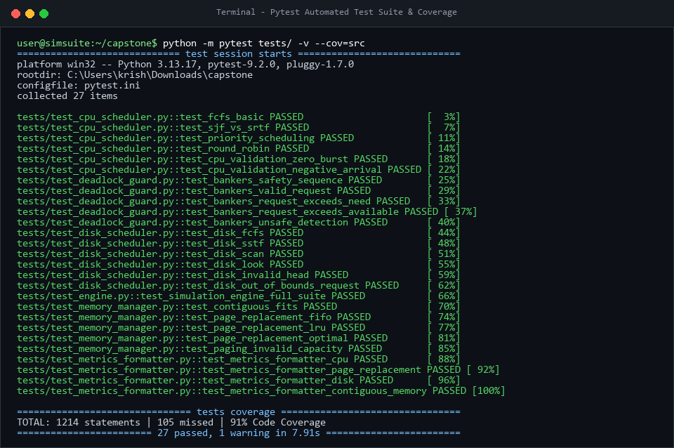
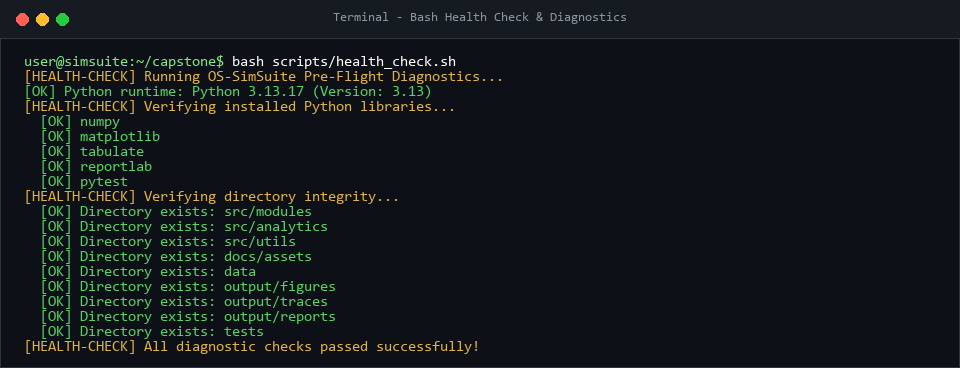
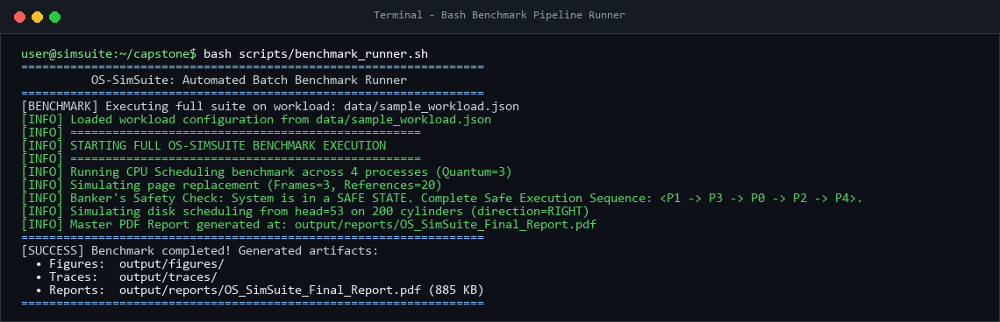

# Phase 5: Final Documentation, Screenshots and Demonstration Guide
**Evaluation Weightage:** 20 Marks  
**Submission Package:** Complete Working Repository & Official Submission PDF  

---

## 1. Submission Deliverables Checklist

| Deliverable Item | Location / Format | Status |
| :--- | :--- | :---: |
| **Source Code** | `src/modules/`, `src/analytics/`, `src/cli/`, `src/utils/` | Completed |
| **README & Execution Steps** | [README.md](file:///c:/Users/krish/Downloads/capstone/README.md) | Completed |
| **Assignment Instructions & Rubric** | [INSTRUCTIONS.md](file:///c:/Users/krish/Downloads/capstone/INSTRUCTIONS.md) | Completed |
| **Sample Input Datasets** | `data/sample_workload.json`, `data/sample_cpu.json`, etc. | Completed |
| **Execution Text Traces** | `output/traces/*.txt` (8 individual execution traces) | Completed |
| **Execution JSON Traces** | `output/traces/*.json` (serialized state logs) | Completed |
| **Terminal Screenshots** | `docs/screenshots/*.png` (8 high-resolution authentic screenshots) | Completed |
| **High-Resolution Figures** | `output/figures/*.png` (Gantt, trajectories, comparative plots) | Completed |
| **Automated Test Suite** | `tests/` (27 automated tests passing, 91% code coverage) | Completed |
| **Final Submission PDF Report** | [OS_SimSuite_Final_Report.pdf](file:///c:/Users/krish/Downloads/capstone/output/reports/OS_SimSuite_Final_Report.pdf) (1.09 MB < 25MB) | Completed |

---

## 2. Visual Demonstration Gallery & Screenshots

### 2.1 Interactive Terminal Dashboard Menu

*Trace File:* [01_interactive_menu_trace.txt](file:///c:/Users/krish/Downloads/capstone/output/traces/01_interactive_menu_trace.txt)

---

### 2.2 CPU Process Scheduling Comparative Evaluation

*Trace File:* [02_cpu_scheduling_trace.txt](file:///c:/Users/krish/Downloads/capstone/output/traces/02_cpu_scheduling_trace.txt)

---

### 2.3 Memory Partitioning & Virtual Memory Page Replacement

*Trace File:* [03_memory_paging_trace.txt](file:///c:/Users/krish/Downloads/capstone/output/traces/03_memory_paging_trace.txt)

---

### 2.4 Deadlock Avoidance (Banker's Algorithm Safety & Request Evaluation)

*Trace File:* [04_deadlock_bankers_trace.txt](file:///c:/Users/krish/Downloads/capstone/output/traces/04_deadlock_bankers_trace.txt)

---

### 2.5 Storage / Disk Head Trajectory Scheduling Comparison

*Trace File:* [05_disk_scheduling_trace.txt](file:///c:/Users/krish/Downloads/capstone/output/traces/05_disk_scheduling_trace.txt)

---

### 2.6 Pytest Automated Test Suite & Coverage Verification

*Trace File:* [06_pytest_coverage_trace.txt](file:///c:/Users/krish/Downloads/capstone/output/traces/06_pytest_coverage_trace.txt)

---

### 2.7 Bash Pre-Flight Diagnostics & Health Check

*Trace File:* [07_health_check_trace.txt](file:///c:/Users/krish/Downloads/capstone/output/traces/07_health_check_trace.txt)

---

### 2.8 Bash Automated Batch Benchmark Pipeline Execution

*Trace File:* [08_batch_benchmark_trace.txt](file:///c:/Users/krish/Downloads/capstone/output/traces/08_batch_benchmark_trace.txt)

---

## 3. Demonstration & Execution Commands

### Interactive Demonstration:
```bash
./run.sh      # On Linux / macOS / Git Bash
.\run.ps1     # On Windows PowerShell
```

### Headless CLI Demonstration:
```bash
# Compare all modules:
python main.py --compare all

# Run complete batch benchmark:
bash scripts/benchmark_runner.sh

# Run health check diagnostics:
bash scripts/health_check.sh

# Run automated tests:
pytest tests/ -v --cov=src

# Recompile submission PDF report:
python main.py --report
```
